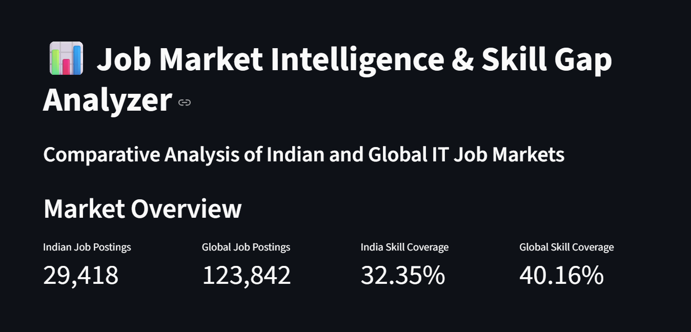
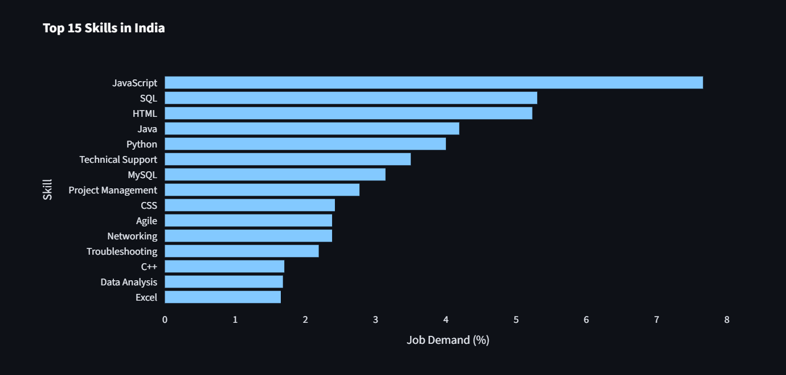

# Job Market Intelligence & Skill Gap Analyzer

An interactive data analytics project that compares skill demand, job roles, and technology trends across Indian and global IT job markets.

## Project Overview

The project analyzes two job-posting datasets to identify:
- In-demand technical and professional skills.
- Differences in skill demand between Indian and global markets.
- Common and market-specific skills.
- Demand patterns across skill categories.
- Job role and location distributions.

An interactive Streamlit dashboard presents the findings through charts, metrics, and tables.

## Datasets

| Dataset | Source | Time Period | Records |
|---|---|---|---:|
| Indian job postings | Naukri | 2019 | 29,418 |
| Global job postings | LinkedIn | 2023–2024 | 123,842 |

## Technologies Used

- Python
- Pandas and NumPy
- Streamlit
- Plotly
- Rule-based text classification
- Taxonomy-based skill extraction
- Data cleaning and exploratory data analysis

## Project Architecture

```text
job-market-intelligence/
│
├── app.py
│
├── data/
│   ├── raw/
│   │   ├── india/
│   │   └── global/
│   │
│   └── processed/
│       ├── india_jobs_clean.csv
│       ├── india_jobs_classified.csv
│       ├── global_jobs_classified.csv
│       ├── india_skills_extracted.csv
│       ├── global_skills_extracted.csv
│       ├── india_skill_demand.csv
│       ├── india_skill_category_demand.csv
│       ├── india_global_skill_comparison.csv
│       ├── india_global_category_comparison.csv
│       ├── common_skills.csv
│       └── market_specific_skills.csv
│
├── src/
│   ├── classify_india_roles.py
│   ├── extract_india_skills.py
│   └── compare_markets.py
│
├── notebooks/
├── reports/
├── sql/
├── requirements.txt
└── README.md
```

Additional processing scripts and intermediate datasets are maintained in the respective folders.

## Methodology

### 1. Data Cleaning
- Removed duplicate and invalid records.
- Standardized column names and text fields.
- Prepared Indian and global datasets for analysis.

### 2. Job Role Classification
- Applied rule-based classification using job titles and available metadata.
- Grouped postings into categories such as Software Development, Data Analytics, AI & Machine Learning, IT & Infrastructure, and Quality Assurance.
- Flagged uncertain Indian classifications for manual review.

### 3. Skill Extraction
- Developed a common skill taxonomy with skill names, categories, and aliases.
- Extracted skills from Indian job skill fields and global job descriptions.
- Standardized detected skills for comparison.

### 4. Market Comparison
- Calculated the number of job postings mentioning each skill.
- Calculated skill demand as a percentage of total postings in each dataset.
- Identified common skills and skills detected in only one dataset.
- Compared demand across skill categories.

### 5. Interactive Dashboard
Built with Streamlit and Plotly.

Dashboard sections:
1. Market Overview
2. Skill Analysis
3. Category Comparison
4. Market Opportunities
5. India Job Analysis

## Key Findings

- The Indian dataset contains 29,418 job postings, while the global dataset contains 123,842.
- 57 unique skills were detected in India and 67 in the global dataset.
- All 57 Indian detected skills were also detected globally.
- Programming category demand was 13.73% in India and 5.90% globally.
- Data Analytics category demand was 3.70% in India and 18.64% globally.
- Database category demand was 8.49% in India and 4.51% globally.
- AI & Machine Learning category demand was 0.90% in India and 1.97% globally.

## Limitations

- The Indian dataset represents 2019, whereas the global dataset represents 2023–2024.
- Skill extraction coverage is approximately 32.35% for India and 40.16% globally.
- Job classification is rule-based and may require manual review.
- Skill extraction depends on the available job descriptions, source fields, and taxonomy.
- Market-only detected skills do not necessarily indicate that a skill is absent from the other market.
- Results should be interpreted as dataset-based observations rather than a direct measurement of current job-market demand.

## How to Run the Project

### 1. Clone or download the repository

### 2. Create a virtual environment

```bash
python -m venv .venv
```

### 3. Activate the environment

Windows PowerShell:

```powershell
.\.venv\Scripts\Activate.ps1
```

### 4. Install dependencies

```bash
python -m pip install -r requirements.txt
```

### 5. Run the dashboard

```bash
python -m streamlit run app.py
```

Open the local URL displayed in the terminal, usually:

`http://localhost:8501`

## Project Objective

To transform large-scale job-posting data into actionable insights about technology skill demand and differences between Indian and global IT job markets.

---

**Project Type:** Data Analytics / Business Intelligence

**Domain:** Job Market Analytics and Skill Gap Analysis

**Interface:** Streamlit Interactive Dashboard

## 📊 Dashboard Preview

### Market Overview


### Skill Analysis


## 🚀 Future Improvements

- Add interactive job-role recommendations.
- Improve job classification accuracy using machine learning.
- Integrate more recent job market datasets.
- Add salary trend analysis and skill gap predictions.